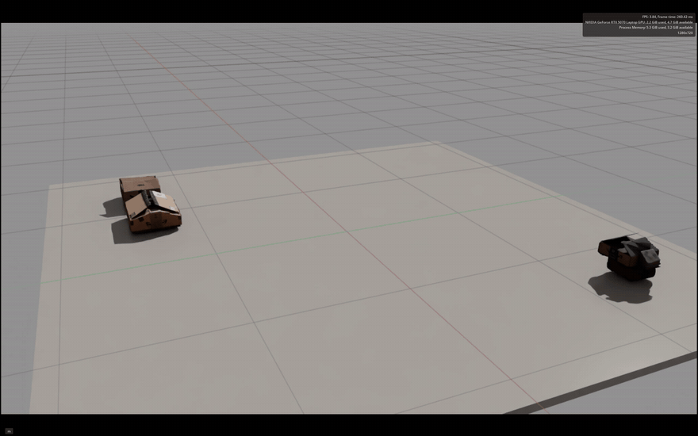
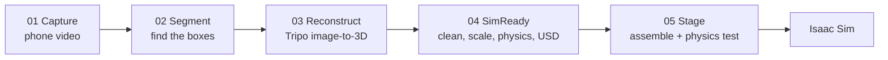
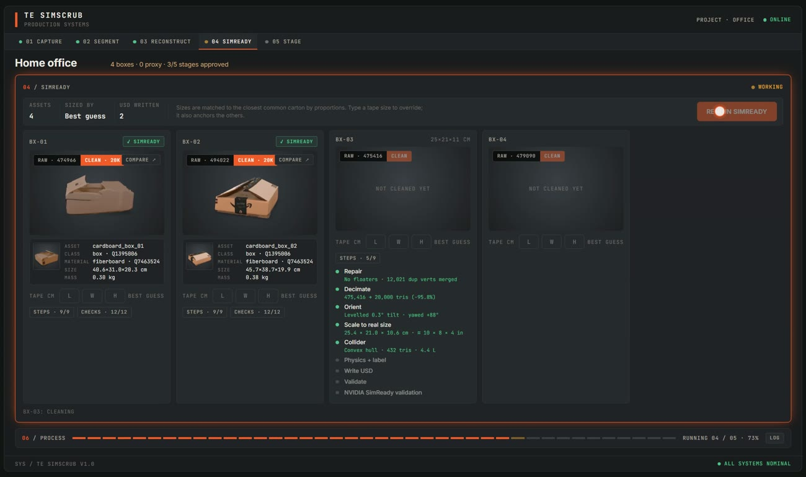
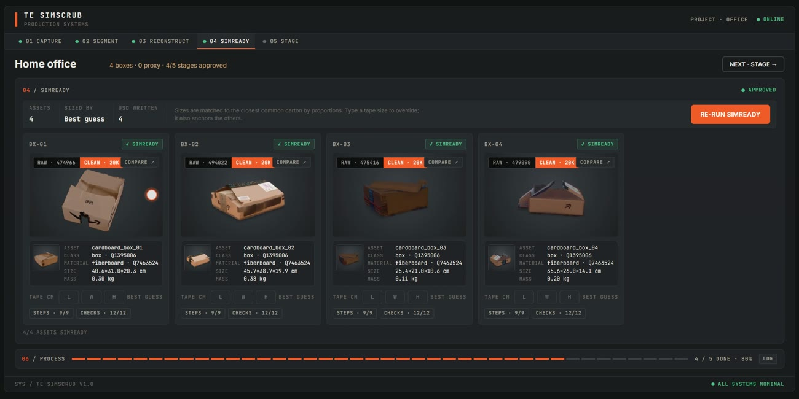

# TE SimScrub

**Video in, SimReady USD out.** Walk through a room with your phone; SimScrub finds every cardboard box, turns each one into a textured 3D model, cleans it into a physics-ready, true-scale [NVIDIA SimReady](https://nvidia.github.io/simready-foundation/latest/guides/getting_started.html) USD asset, and drops them all into Isaac Sim.

It is built for artists, not pipeline engineers: every step happens in the open, says what it did and why, and lets you step in (exclude a bad detection, type a tape measurement, re-run one stage) without touching a command line.

[](docs/media/simscrub_demo_1min.mp4)

▶ **[Watch the 1-minute demo](docs/media/simscrub_demo_1min.mp4)**: phone video → boxes found → Tripo meshes → SimReady cleanup → Isaac Sim drop test.

---

## The pipeline at a glance



| Stage | In plain words | What comes out |
|---|---|---|
| **01 Capture** | Pulls sharp still frames out of your video. | ~8 frames per second of footage, blurry ones dropped |
| **02 Segment** | Finds every cardboard box, follows each one through the video, and cuts out its best view. | One clean cut-out image per box |
| **03 Reconstruct** | Sends each cut-out to Tripo, which builds a textured 3D model from a single photo. | A raw textured mesh per box (up to 500k triangles) |
| **04 SimReady** | Cleans each mesh, sizes it to real-world units, gives it physics, and writes a validated USD asset. | `cardboard_box_NN.usda` + texture + thumbnail |
| **05 Stage** | Places the boxes on a floor the way they sat in the room, then checks they settle under real physics. | `stage.usda`, opened in Isaac Sim |

The job folder (`jobs/<name>/manifest.json`) is the single source of truth. Every stage reads it and writes to it, so you can re-run any one stage without redoing the others, and nothing that cost money (Tripo credits) is ever paid for twice.

---

## How each step works

### 01 Capture: getting good frames

Phone video is mostly motion blur. Capture samples the video at 8 fps, scales frames to 1600 px, scores each frame's sharpness (variance of the Laplacian: how much fine edge detail it has), and drops frames much blurrier than the median. The **Capture** tab plays your video back first, so you can confirm you picked the right one before anything runs.

### 02 Segment: finding the boxes

1. **Detection.** [YOLOE](https://docs.ultralytics.com/models/yoloe/) is an open-vocabulary model: instead of a fixed list of classes, you give it text. SimScrub asks only for `cardboard box` and `brown cardboard box`, so chairs, desks and guitars are ignored. Free weights download from the Ultralytics GitHub releases on first run.
2. **Tracking.** The same box shows up in dozens of frames. An IoU tracker links detections frame-to-frame, with **camera-motion compensation**: optical flow on the background estimates how the phone moved, so a box that pans out of view and comes back keeps the same ID instead of becoming a duplicate.
3. **Best view.** For each box, the clearest view (large, sharp, not cut off by the frame edge) is cropped from the **full-resolution** source frame with a transparent background.
4. **Artist check.** Weak tracks (low confidence, seen only briefly) are pre-excluded with a reason. Tap any box in **02 Segment** to keep or drop it; only kept boxes cost credits in the next step.

### 03 Reconstruct: photo to 3D

Each kept crop goes to the Tripo image-to-3D API (model v3.1, standard texture, 30 credits per box), capped at 500k triangles. The tab shows the cost and your balance **before** you spend anything, and every result is cached by a hash of the crop image, so re-runs are free. **Regenerate** deliberately pays for a fresh batch. If Tripo fails for a box, it becomes a fitted placeholder cuboid with a plain-language reason, so the pipeline never dead-ends.

The raw meshes are shown exactly as Tripo returned them, live and rotatable, so you can judge them before cleanup.

### 04 SimReady: from raw mesh to sim asset

Raw generated meshes are heavy, unitless, arbitrarily oriented and have no physics. SimReady fixes that in nine visible steps per box. Each step reports what it changed, with a hover explanation:



#### 1. Repair
Generated meshes come with junk: duplicated vertices along texture seams, zero-area triangles, and small floating fragments ("floaters") the AI hallucinated around the object. Using [MeshLab](https://pymeshlab.readthedocs.io/) it:
- **merges duplicate vertices** (this often re-joins pieces that only *looked* separate),
- **drops degenerate and duplicate faces**,
- **removes floaters**: any disconnected piece smaller than 1% of the mesh (at least 50 triangles) is noise, not part of the box.

The step counts each of these so you can see the mesh was actually changed (e.g. *"No floaters · 12,021 dup verts merged"*).

#### 2. Decimate: ~475k → 20k triangles
A simulator doesn't need half a million triangles for a cardboard box; it needs a light mesh that still looks right. SimScrub uses **quadric edge collapse** decimation:

- The mesh is simplified by repeatedly **collapsing an edge** (merging its two vertices into one), which removes a couple of triangles each time.
- Which edge goes next is decided by a **quadric error metric**: every vertex remembers the planes of the triangles around it, and the cost of a collapse is how far the merged vertex would drift from those planes. Flat areas (the sides of a box) cost almost nothing to simplify; corners, folds and flaps cost a lot, so they're kept.
- **Optimal placement** puts each merged vertex at the position that minimises that error, rather than just picking one of the two originals.
- The **texture-aware** version also weighs **UV coordinates** in the error, and **boundary preservation** keeps UV seams and open edges in place, so the photo texture still lands on the same spots of the box after 95% of the triangles are gone.

The target is 20,000 triangles. A typical box goes from **475,416 → 20,000 tris (−95.8%)** with no visible change in the viewer; **Compare** shows raw and clean side by side so you can check.

#### 3. Orient
glTF meshes are Y-up; USD stages for Isaac Sim are Z-up. The mesh is rotated to Z-up, then an **oriented bounding box** (the tightest box that fits the mesh at any angle) finds the box's own axes. If one face is within 25° of flat, the box is **levelled** onto it, turned so its long side runs along X, and its base is set on z = 0. If no face is clearly the bottom, Tripo's up is trusted and only the rotation around the vertical is fixed.

#### 4. Scale to real size
A mesh from a single photo has the right **proportions** but no real **size**. If you typed a tape measurement, that wins. Otherwise SimScrub makes a best guess: it compares the box's length : width : height ratios against a catalog of common stock shipping cartons (6×4×4 in up to 24×18×12 in, trying every way the box could be lying), picks the closest match, and scales uniformly so the mesh keeps its own shape. A small preference for mid-size parcels breaks ties (proportions alone can't tell 8×6×4 from 16×12×8), and if any box *was* measured, that preference centres on your measured boxes instead. The card always shows where the size came from: **tape** or **best guess**.

#### 5. Collider
Physics engines collide against simple shapes, not render meshes. A **convex hull** (the shape you'd get by shrink-wrapping the box) is authored with `UsdPhysics.MeshCollisionAPI` (`approximation = convexHull`). PhysX builds the same hull when it loads, so the triangle count and volume shown are what the simulator actually uses.

#### 6. Physics + label
- **Mass** = box surface area × 550 g/m² (single-wall corrugated cardboard): an empty box weighs what its cardboard weighs.
- **Physics material**: static friction 0.55, dynamic 0.45, restitution 0.1 (cardboard doesn't bounce).
- **Semantic labels** for synthetic-data and perception training: `wikidata_class = cardboard box`, `wikidata_qcode = Q1395006`; materials labelled corrugated fiberboard `Q7463524`.

#### 7. Write USD
Writes the asset in the SimReady package layout (below): the cleaned mesh with outward-facing triangles and per-face-corner normals, the texture as an sRGB `UsdPreviewSurface`, a display-colour fallback, physics, labels, a grasp guide line, provenance metadata, and a 256×256 thumbnail rendered with the same viewer the app uses.

#### 8. Validate (fast)
SimScrub's own rule registry (`simscrub/usd/validate.py`) re-opens the written file and checks it: meters, Z-up, default prim, plausible real-world size, collider, rigid body + mass, material/texture, semantic label, plus where the size came from.

#### 9. NVIDIA SimReady validation (official)
Runs NVIDIA's own `simready-validate` against the **Robotics-Prop 4.0.0** profile and stamps the result into the asset. All four demo boxes pass **9/9 required features**, and each card shows a **✓ SimReady** badge with the full spec sheet behind it.



MeshLab is native code, so repair and decimate each run in an **isolated child process**: a crash in a bad mesh shows up as a red step on that one box, not a dead server.

### 05 Stage: into Isaac Sim

- **Assemble** builds `stage.usda`: each SimReady asset as a USD **reference** (re-running SimReady updates the stage automatically), a floor collider, a physics scene with gravity, and lights. Positions are estimated from the video frame (phone assumed at 1.3 m height, tilted 20° down); a box seen sitting on another is **stacked**, and overlaps are pushed apart. Boxes spawn 2 cm up and settle under gravity. Eight stage checks run on the written file.
- **Test physics** runs real PhysX in Isaac Sim with no window (`isaac/settle.py`) for 4 simulated seconds and reports, per box, how far it dropped, slid and tilted, and whether it came to rest.
- **Launch Isaac** opens the stage in the full Isaac Sim window, framed so every box is in view. While it's open, the **Stage** tab drives it: **Drop test** lifts every box (40 cm, then 80 cm) and lets them fall onto the floor and each other; **Play** / **Stop** control the simulation. Drops are edited only in Isaac's session layer: the stage file on disk is never changed.

---

## The SimReady asset format

Every box is a [SimReady](https://nvidia.github.io/simready-foundation/latest/guides/getting_started.html) asset, profile **Robotics-Prop 4.0.0**:

```
assets/cardboard_box_01/simready_usd/
  cardboard_box_01.usda                      main file (NP.005 layout)
  textures/cardboard_box_01_albedo.png
  .thumbs/256x256/cardboard_box_01.usda.png  thumbnail (SR.002)
  .simready/validation.json                  NVIDIA validator report
```

- Root `Xform`, `kind=component`, `assetInfo` (identifier, name, version); Z-up, meters, kilograms.
- `Geometry/<name>`: rigid body + mass, Wikidata semantic labels; mesh with faceVarying normals, displayColor and a convex-hull collider.
- `VisualMaterials` (UsdPreviewSurface, sRGB texture) and `PhysicsMaterials` (friction, restitution), both labelled corrugated fiberboard `Q7463524`; a `Grasp` guide line.
- `customLayerData.SimReady_Metadata`: author, asset name/type/license, category, source file, generation date, qcode, rigid-body count, extents, mass, and the validation stamp. Pipeline provenance (source video, Tripo task, size source) sits separately under `SimScrub`.

---

## Run it

```bash
# backend
python -m venv .venv
.venv/Scripts/python -m pip install -e .[dev]
.venv/Scripts/python -m pip install torch torchvision --index-url https://download.pytorch.org/whl/cu128
.venv/Scripts/python -m pip install ultralytics opencv-python
.venv/Scripts/python -m uvicorn server.app:app --port 8000

# frontend (second terminal)
cd ui && npm install && npm run dev
```

Open http://localhost:5173, drop a walkthrough video into **01 Capture** (or pick one in the project folder), check it in the preview, and press **Process**.

Tripo needs `TRIPO_API_KEY=...` in `.env` (git-ignored) and API credits, which are separate from a Tripo Studio plan.

### Headless (same code, no UI)

```bash
.venv/Scripts/python -m simscrub.cli segment path/to/walkthrough.mp4 --job office
.venv/Scripts/python -m simscrub.cli reconstruct --plan   # cost + Tripo balance, spends nothing
.venv/Scripts/python -m simscrub.cli reconstruct          # textured mesh per kept box (cached)
.venv/Scripts/python -m simscrub.cli simready             # the nine cleanup steps
.venv/Scripts/python -m simscrub.cli validate jobs/office/assets/cardboard_box_01/simready_usd/cardboard_box_01.usda
.venv/Scripts/python -m simscrub.cli assemble             # stage.usda: boxes + floor + physics
```

### NVIDIA SimReady validator (optional, step 9)

Needs Python 3.12 and a clone of the SimReady Foundation repo:

```bat
git clone https://github.com/NVIDIA/simready-foundation %USERPROFILE%\.simscrub\simready-foundation
py -3.12 -m venv %USERPROFILE%\.simscrub\simready-venv
cd %USERPROFILE%\.simscrub\simready-foundation && %USERPROFILE%\.simscrub\simready-venv\Scripts\pip install -r requirements.txt
```

Without it, step 9 is skipped with a note and everything else still works.

### Isaac Sim (optional, Stage tab)

Isaac Sim 5.1 installs with pip into its own Python 3.11 venv, outside OneDrive, at `%USERPROFILE%\.simscrub\isaac-venv` (override with `SIMSCRUB_ISAAC_VENV`):

```bat
py -3.11 -m venv %USERPROFILE%\.simscrub\isaac-venv
%USERPROFILE%\.simscrub\isaac-venv\Scripts\python -m pip install "isaacsim[all,extscache]==5.1.0.0" --extra-index-url https://pypi.nvidia.com
```

Launching Isaac Sim from the app accepts the NVIDIA Omniverse EULA (`OMNI_KIT_ACCEPT_EULA=YES`). On 8 GB laptop GPUs (below Isaac Sim's 10 GB minimum) the default Vulkan renderer crashes at startup, so SimScrub runs Isaac Sim on Direct3D 12 (`--/app/vulkan=false`), which works.

---

## Code map

| Path | What |
|---|---|
| `simscrub/manifest.py` | Job manifest: the single source of truth every stage reads and writes |
| `simscrub/stages/capture.py` | Frame extraction and sharpness scoring |
| `simscrub/stages/segment.py` | YOLOE box finding, motion-compensated tracking, crops |
| `simscrub/stages/tripo.py` | Tripo v3 API client (upload, image-to-model, poll, download, balance) |
| `simscrub/stages/reconstruct.py` | Mesh per box, cache, proxy fallback, per-box visible steps |
| `simscrub/stages/meshops.py` | MeshLab repair + decimate, each in an isolated child process |
| `simscrub/stages/simready.py` | The nine SimReady steps |
| `simscrub/sizing.py` | Best-guess real size from proportions (common carton catalog) |
| `simscrub/usd/author.py` | Writes one SimReady box asset as USD |
| `simscrub/usd/validate.py` | Rule-registry validator (fast first pass) |
| `simscrub/usd/nvidia_validate.py` | Runs NVIDIA's `simready-validate` and summarises it for the UI |
| `simscrub/stages/assemble.py` | Stage assembly: placement, stacking, floor, physics, stage checks, preview |
| `isaac/settle.py` | Headless Isaac Sim physics settle test |
| `isaac/open_stage.py` | Opens the stage in Isaac Sim, frames the camera, takes Drop / Play / Stop commands |
| `simscrub/pipeline.py` | Stage runners shared by the CLI and the server |
| `simscrub/errors.py` | Exceptions mapped to plain-language chips for the UI |
| `simscrub/cli.py` | Command line entry point |
| `server/app.py` | FastAPI server; pushes the manifest over `/ws` after every change |
| `ui/` | React + Vite front end, one tab per stage, live 3D via `<model-viewer>` |
| `ui/scripts/` | Playwright checks and the demo recorders (`record_demo.mjs`, `record_screen.mjs`) |
